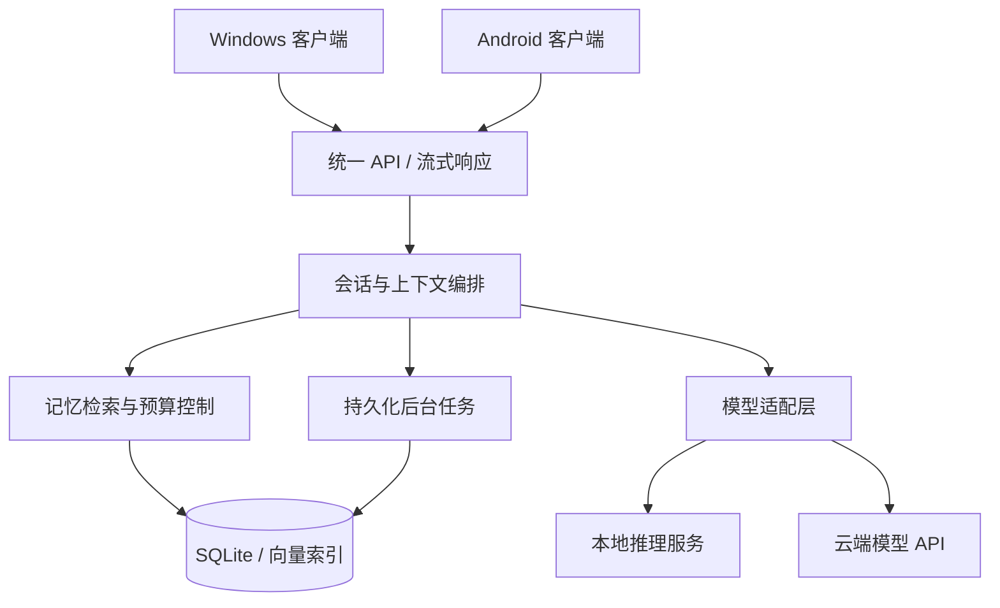

# 系统架构草案

状态：讨论稿。Android 首阶段采用连接电脑 / 自托管服务的方式已确认；以下技术选型为建议。

## 一、部署形态

服务部署在个人 Windows 电脑，或用户自行管理的常开主机，后续包括 Mac mini。Windows 客户端可使用本机服务，也可连接自托管服务；Android 使用相同协议连接服务。后端核心应保持跨平台，客户端的系统功能通过平台适配层执行。

第一版不建设多租户公共云平台。多设备共享服务中的同一份记忆，不在两端各建一个可写主库，降低冲突和重复提取的复杂度。

## 二、推荐技术栈

| 层 | 建议 | 原因与限制 |
| --- | --- | --- |
| 客户端 | Flutter / Dart | 共享 Windows 与 Android UI、状态管理和网络代码；安装与后台生命周期仍需平台适配 |
| API 服务 | Python + FastAPI | 适合接入模型、检索与后台任务；Windows 发布时需要打包 Python 服务 |
| 接口约定 | OpenAPI + SSE | 普通操作走 HTTP，聊天以 SSE 流式返回；取消请求需在服务端传播 |
| 主数据 | SQLite | 先服务单个用户，使用事务及迁移脚本；不把数据库文件放进网盘做多端并发同步 |
| 向量检索 | sqlite-vec，封装可替换接口 | 适合先验证个人规模的数据；精确向量扫描随数据增长变慢，大规模时评估 Qdrant 等索引 |
| Embedding | 独立可配置适配层 | 优先本地中文 / 多语言模型；根据机器与实际召回效果选择，不与聊天模型绑定 |
| 后台作业 | SQLite 任务表 + 有限并发 worker | 提取、摘要、索引、清理可重试；服务重启后可恢复 |
| 模型推理 | 连接 Ollama / 兼容接口服务 / 云端 API | 第一版接入已有推理服务，不自研推理引擎 |

如果后续需要云端多用户服务，再依据并发与隔离需求迁移 PostgreSQL、独立向量服务和专用任务队列。第一版不预先引入这些基础设施。

## 三、模块职责

| 模块 | 职责 |
| --- | --- |
| 客户端 | 聊天、会话列表、连接配置、记忆管理、状态和错误展示 |
| 会话编排 | 消息落库、构建有预算的上下文、调用模型、保存回答、处理取消 |
| 模型适配 | 流式输出、超时、能力探测、错误归一化；区分聊天和 embedding 配置 |
| 记忆服务 | 候选检索、相关性过滤、来源追踪、纠错、置顶、遗忘 |
| 回忆档案 | 珍藏事件、时间轴、原始片段溯源与历史分页查询 |
| 设备能力 | 能力发现、目标设备选择、参数校验、闹钟 / 时间 / 电话适配与执行回执 |
| 后台 worker | 增量提取、摘要压缩、去重与索引更新 |
| 数据与迁移 | 用户 / 会话 / 消息 / 记忆 / 来源关系 / 任务 / 版本管理 |
| 设备与访问 | 配对、设备令牌、撤销访问、服务连接与传输加密 |
| 备份与恢复 | 一致性备份、带版本的逻辑导出、迁移与恢复验证 |

模块间通过接口协作。更换聊天模型不应删除记忆；更换 embedding 模型需要重建向量，并按模型名、版本和维度区分索引。

## 四、一次聊天的前台路径

1. 校验设备身份和会话归属，持久化用户消息。
2. 读取有长度上限的近期消息和会话摘要。
3. 对当前问题检索少量候选记忆，相关性不足时可以不注入任何长期记忆。
4. 在上下文预算内拼装消息，并为模型输出预留空间。
5. 流式返回回答，保存完成 / 中断状态。
6. 提交增量记忆与摘要任务；前台不等待这些整理任务完成。

记忆检索失败时可使用近期上下文继续回答，并展示记忆暂不可用。后台处理失败不得伪报为成功。非幂等请求不静默重放，模型回复过程不自动切换供应商，以免产生重复内容或意外的数据发送。

## 五、跨设备与连接

- 桌面服务默认监听 `127.0.0.1`，本机即可使用。
- 开启手机连接时，引导用户配置服务地址与设备配对。局域网不能作为身份验证的替代；访问需要设备令牌与受保护的传输。
- 第一版以手动输入地址 / 扫描配对码为目标；公网访问优先用户自建 HTTPS 或受信任的加密组网，不自动配置路由器端口转发。
- 云端模型密钥由服务端保存，客户端只持有 yf 的设备凭据。凭据使用操作系统安全存储；日志不记录密钥和默认的完整聊天正文。
- 客户端显示服务可用性和后台记忆任务状态；断网时保留输入草稿，不承诺后台自动发送聊天。
- 服务端是首阶段的记忆主库；手机离线查看、离线写入与冲突合并是独立后续项目。

## 六、产品入口

产品以日常陪伴为主。第一版客户端至少包含聊天、会话、回忆、设置四个入口；回忆页承载记忆管理、珍藏与时间轴，支持搜索、查看来源、纠错、删除与置顶；设置页管理服务连接、模型、人格偏好、数据导出和备份。

日常任务先接查时间、闹钟和系统拨号入口，具体边界见 [设备能力设计](device-capabilities.md)。服务端模型给出结构化意图，由客户端调用受限制的系统适配器，并反馈真实状态；不能仅凭模型回答就宣称操作成功。

后续可扩展语音输入输出、附件与个人知识库、主题与更多工具。扩展通过明确接口加入；对外发消息、修改文件等实际动作需有权限边界与可见的执行结果。

## 七、交付与工程约束

- Windows 目标：可安装或解压运行的桌面客户端，后端随包分发或有清晰的安装流程；模型权重单独选择和下载。
- Android 目标：可安装的 APK；正式发行需签名，签名文件与口令独立保存。
- 首轮开发后建立后端测试、Flutter 检查与构建流程；Android 构建使用受支持的 Flutter / Android SDK / JDK 组合。
- GitHub 只存代码和必要文档，模型权重、运行数据库与用户聊天不进入仓库。
- 发布包、模型和数据库迁移各自标注版本；更新前备份数据，并验证恢复路径。
- 核心数据可从 Windows 迁至 macOS / Linux 服务；操作系统凭据独立配置，模型与向量索引可替换，迁移不要求重新开始记忆。
- 备份、来源与数据版本从最初的数据层实现，不能等积累多年记忆后再补。
